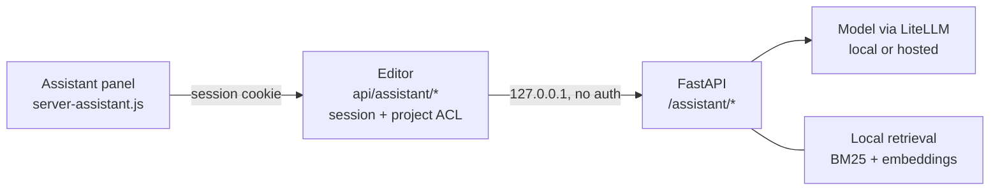

# Server assistant

Optional, off by default. A chat panel on the Projects list and on every project page that:

- answers questions about the editor and about the open project's saved metadata;
- searches the project's sources (External resources and documents added to the chat) and cites them
  as `name p.N`;
- drafts field values as cards, fills fields from the sources, and reviews a record for empty, unclear
  or inconsistent required and recommended fields;
- on a data file page, drafts the file's description and labels its variables from a codebook or
  questionnaire.

The model, retrieval and tools run on the FastAPI data service (`metadata-editor-fastapi`, see
`README-assistant.md` there). The browser only talks to this editor: `api/assistant/*` checks the
session and the project's permissions, builds what the model may read, and relays the answer.



## Enable

1. Install the assistant on the FastAPI service and check `curl -s localhost:8000/assistant/status`
   (its `README-assistant.md`, section Install).
2. Run the database migrations, which add the `assistant_project_settings` table:

   ```sh
   php index.php cli/migrate/latest
   ```

3. In `application/config/editor.php`, set:

   ```php
   $config['editor']['server_assistant_enabled']=true;
   ```

   `data_api_url` in the same file must reach the FastAPI service (default `http://localhost:8000/`).

4. Optional: `node tools/assistant-docs.mjs` (Node 18+) mirrors the published editor guide, the schema
   guide and this editor's API reference into `assistant-docs/` for the assistant to search. The
   FastAPI service reads them, and `assistant-help.md`, through `ASSISTANT_DOCS` and
   `ASSISTANT_HELP_PATH`.

The panel appears on the next page load. With the setting off, no assistant code is loaded,
`api/assistant/status` answers `enabled: false` and every other `api/assistant/*` request returns 404.

### Web server

Chat answers stream (`text/event-stream`). Apache with mod_php streams as is. PHP-FPM needs
`flushpackets=on` on its Apache `ProxyPass` / `SetHandler` line, Nginx needs nothing (the proxy sends
`X-Accel-Buffering: no`), and IIS needs `responseBufferLimit="0"` on the PHP FastCGI handler. A chat
turn or a fill can take minutes, so web server timeouts must be at least 300 s (Apache `Timeout`,
Nginx `fastcgi_read_timeout`, IIS FastCGI `activityTimeout` and `requestTimeout`).

## Settings

In `application/config/editor.php`:

| Setting | Default | |
|---|---|---|
| `server_assistant_enabled` | `false` | mounts the panel and the `api/assistant/*` routes |
| `server_assistant_rate_per_minute` | `20` | chat turns per minute per session, `0` = no limit |
| `server_assistant_field_suggestions` | empty | per-field allowed values, JSON Pointer => list; a listed field is filled only with one of them |
| `server_assistant_fields` | 13 core fields | fields offered when a project's template cannot be read; otherwise every field of the template is used |

Which model answers, provider keys, local-only mode and limits are set on the FastAPI service
(`assistant.env`, `assistant.models.yaml`).

## Permissions

The assistant adds no permission of its own. Every request checks the session and the project ACL:

| Action | Needs on the project |
|---|---|
| Chat, search sources, Review this record (findings only) | `view` |
| Proposals and Fill in form, fill from sources, data file drafts | `edit` |
| Label variables (writes accepted labels; skips any variable changed since; returns values to undo) | `edit` |
| Add a source, and save it as an External resource | `view` to attach; `edit` to save |
| **Keep on this server** switch | `admin` |

On the Projects list there is no project, so the assistant answers from the editor's help and
documentation only.

The service is never reached from the browser and has no authentication of its own: keep it bound to
127.0.0.1 (its default) or a trusted network.

## What is sent to the model

Per turn, the proxy (`libraries/Assistant_context.php`) sends:

- the project's saved metadata, read the way `api/editor/json` reads it with private fields excluded;
- the template's fields: label, section, help text, required or recommended, controlled-list options;
- the project's data files and, for the open file, its variables' names, labels, descriptions, question
  text and universe (up to 500). **Never data values**;
- passages of the ticked sources that match the question, not whole documents;
- the open section, and the last six messages of the chat.

Where it goes depends on the model the service is configured with. A **local** model keeps everything
on your servers. With a **hosted** model (OpenAI, Azure OpenAI, Anthropic, Gemini, OpenRouter) the
items above leave your infrastructure, so choose a provider your organisation has approved for
project metadata. Two controls:

- **Keep on this server** (per project, set by a project administrator in the panel): only models the
  service marks `local: true` answer for that project, with no fallback to a hosted one. Stored in
  `assistant_project_settings`.
- `ASSISTANT_LOCAL_ONLY=1` on the service: no hosted model is offered at all.

Neither the proxy nor the service logs questions, record values or answers.

## Write paths

The assistant never saves a record. A proposal becomes a value only when the curator clicks
**Fill in form**, which types it into the editor's own field through the field's component, as if
typed: the form becomes dirty, validation runs, and nothing is saved until the curator saves.

Two actions do write, each after an explicit click and with the curator's own permissions:

- **Apply** in Label variables (`POST api/assistant/labels`) writes the accepted labels, descriptions
  and question text into the variables, skips any variable changed since the suggestion, and returns
  the replaced values for **Undo**.
- **Save as resource** on an added document stores it as an External resource of the project.

Documents added to the chat are written to `<storage_path>/assistant-tmp` only while the request
runs: the service reads and indexes them, then the file is deleted. Their index entries are scoped to
the project and the user who added them.

## Endpoints

`application/controllers/api/Assistant.php`; all take the session cookie like the rest of `api/`.

| Method | Path | |
|---|---|---|
| GET | `api/assistant/status?sid=` | panel bootstrap: enabled, models, retrieval state, project summary, the user's permissions |
| POST | `api/assistant/chat` | one turn; relays the service's Server-Sent Events (protocol `pslm-server/1`) |
| POST | `api/assistant/suggest` | one-shot draft: a data file description or one field |
| POST | `api/assistant/review` | start a job: `record` review, `document` fill of every field from the sources, or `variables` labelling; returns `job_id` |
| GET / DELETE | `api/assistant/review/{job_id}` | a job's status and result / cancel it (only the session that started it) |
| POST | `api/assistant/labels` | write accepted variable labels |
| GET | `api/assistant/sources?sid=` | the project's sources and their index state |
| POST | `api/assistant/attach` | add a document (PDF, text, Markdown, CSV, JSON, XML, HTML); `save=1` also stores it as an External resource |
| DELETE | `api/assistant/sources/{id}` | forget a chat attachment |
| POST | `api/assistant/extract` | text of a file in this project's storage folder |
| POST | `api/assistant/settings` | set the project's Keep on this server switch (`admin`); `status` returns its value |

## Files

| File | |
|---|---|
| `application/controllers/api/Assistant.php` | the proxy: session, ACL, rate limit, context, streaming relay |
| `application/libraries/Assistant_context.php` | what the model may read about a project |
| `application/models/Assistant_settings_model.php` | the Keep on this server switch |
| `application/migrations/20261117000001_assistant_project_settings.php` | its table |
| `application/views/metadata_editor/assistant_panel.php` | mounts the panel (renders nothing when disabled) |
| `vue-app/assets/server-assistant.js` | the panel: a framework-free web component in a shadow root |
| `vue-app/assets/server-assistant-fill.js`, `assistant-form.js` | Fill in form through the editor's own field components |
| `assistant-help.md` | the help text the assistant is grounded in |
| `tools/assistant-docs.mjs` | mirrors the documentation it searches into `assistant-docs/` |

The router in `index_vuetify_main_app.php` tells the panel which section and data file are open, and
the data file form accepts a drafted description (`vue-datafile-edit-component.js`).

## Troubleshooting

| Symptom | Cause |
|---|---|
| No panel | `server_assistant_enabled` is false, or the page was cached before it was set |
| "The assistant service is not reachable." | FastAPI is down, `data_api_url` is wrong, or the assistant is not installed there (`/assistant/status` 404) |
| Answers appear all at once at the end | the web server buffers the stream (see Web server) |
| An answer stops after a minute or so | a web server timeout below 300 s |
| Adding a document fails | the service cannot read `<storage_path>/assistant-tmp`: the FastAPI service user needs the shared group its install script sets up with `STORAGE_PATH` |
| "The assistant settings table is missing" | run `php index.php cli/migrate/latest` |
| Retrieval `failed` in status | `assistant-docs/` was not generated (`node tools/assistant-docs.mjs`), or the service cannot read it |
